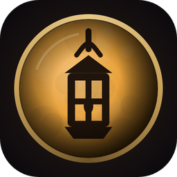
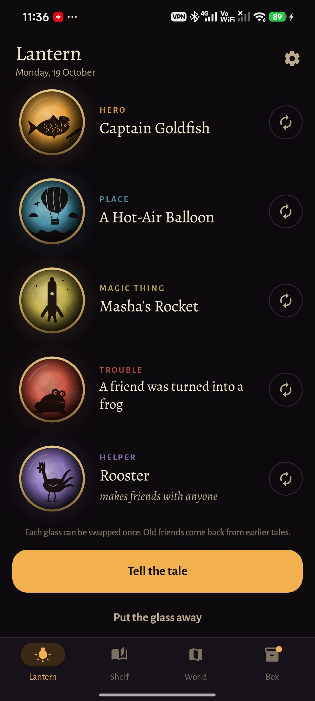
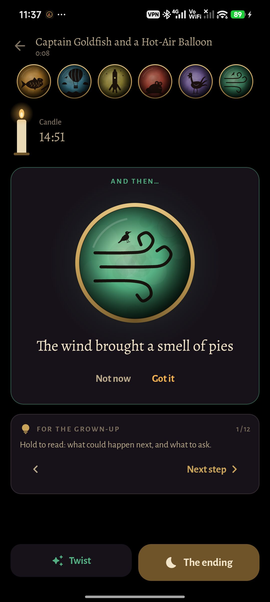
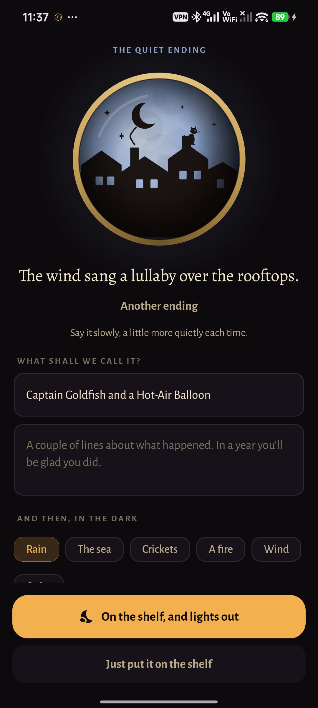
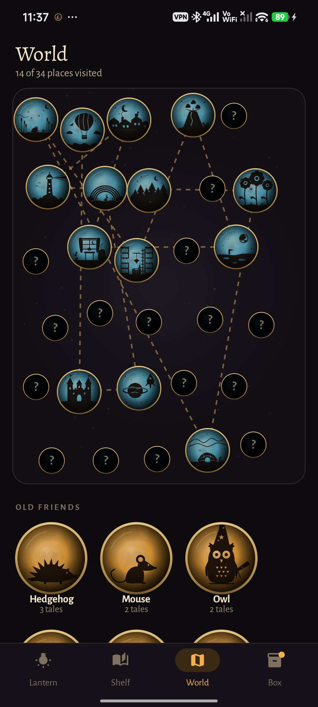
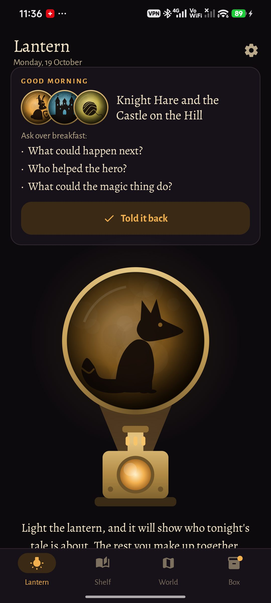
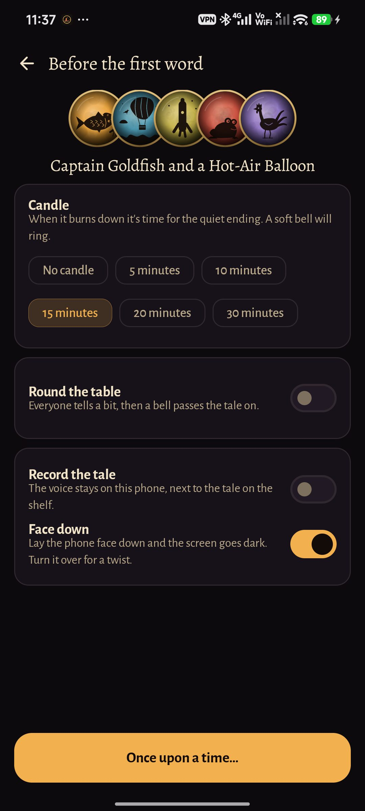
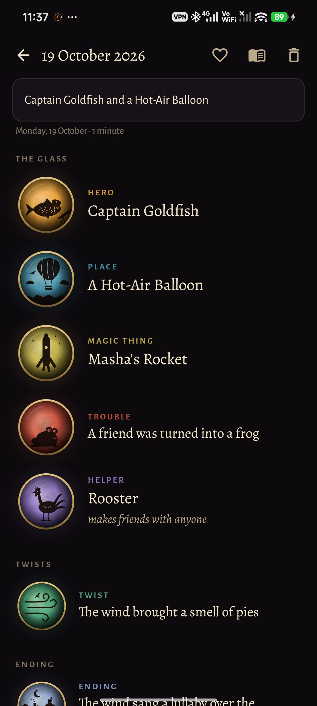
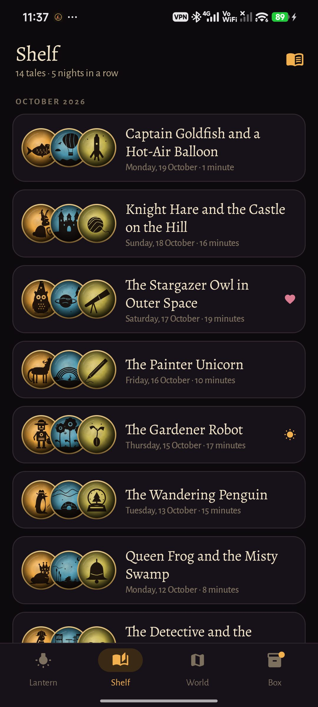
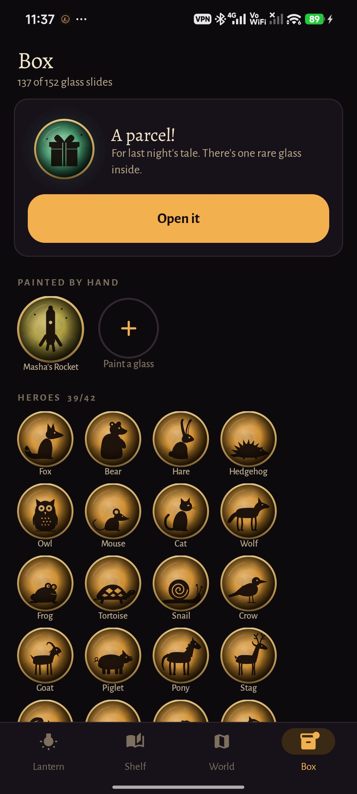

<div align="center">



# Lantern

### Bedtime tales you make up together.

*A magic lantern on the phone: light it, and slides of painted glass come out — a hero, a place, a magic thing, a trouble, a helper. The parent and the child make up the tale from them, with the phone face down. Free, no ads, no account, no internet permission.*

[](https://github.com/bigdevwhale/lantern/actions/workflows/android.yml)
[](https://github.com/bigdevwhale/lantern/releases/latest)


[](LICENSE)

**English** · [Русский](README.ru.md) · [Changelog](CHANGELOG.md)

   

</div>

---

## How it works

1. **Light the lantern** (or shake the phone). The glass comes out one slide at a time: a hero with a job (*Lamplighter Mouse*, *Captain Fox*), a place, a magic thing with a power, a trouble, a helper, and a quirk if you like. Each slide can be swapped once.
2. **Tell it.** Lay the phone face down and the screen goes dark. Turn it over and the lantern gives a twist. A candle says when it's time to finish; tell it round the table and a bell passes the tale on. Hold the grown-up's card for the next step of the tale (after Propp) and a question to ask the child.
3. **The quiet ending.** An ending slide, a name for the tale, and lights out to rain, the sea, crickets, a fire or the wind, made on the phone as it plays.

## What else

| | |
|---|---|
| 🎞 **Many slides** | 42 heroes × 28 jobs, 34 places, 48 magic things × 40 powers, 38 troubles (in three levels of scary), 30 helpers' skills, 32 quirks, 36 twists, 18 endings. All cut-outs in the manner of Lotte Reiniger's shadow films, drawn in code. |
| 🧒 **Little ones / bigger ones** | Three to five: a hero, a place, maybe a thing. Six and up: the whole set. |
| 👋 **Old friends** | Heroes from earlier tales come back. Call one into tonight's tale from the World tab. |
| 🗺 **The world** | A night map of every place your tales have been, joined by a dotted road. |
| 📦 **The box** | Every evening with a tale brings a parcel with one rare slide. Winter glass comes out in winter. |
| 🖌 **Painted by hand** | The child paints a hero, a helper, a place or a thing with a finger; it goes into the lantern with the rest. |
| 📞 **A tale over the phone** | Both phones deal the same glass from one five-digit code, for a parent far away. |
| 🎙 **The shelf** | Every tale kept with its glass, a few written lines and, if you like, the recording. Sequels with the same hero. A little PDF book to print. |
| ☀️ **The morning after** | A widget and a card with last night's glass and three questions to tell it back. |

## Privacy

No account, no cloud, no analytics and no internet permission. The microphone is used only when you choose to record a tale; the recording stays on the phone.

## Screenshots

    

## Build

```bash
./gradlew assembleDebug             # app.lantern.dev
./gradlew assembleDebug -Pdemo      # app.lantern.demo, a made-up family's three weeks of tales
bash tools/capture.sh <dir> en|ru   # screenshots from a -Pdemo -Pshots build
./gradlew testDebugUnitTest         # unit tests
./gradlew testDebugUnitTest -Prender --tests '*RenderArt*'   # every cut-out to app/build/art
```

Kotlin, Jetpack Compose, Room, DataStore. Fonts: Alegreya and Alegreya Sans (OFL).

Part of [Stillcraft](https://bigdevwhale.github.io/stillcraft/). MIT licence.
