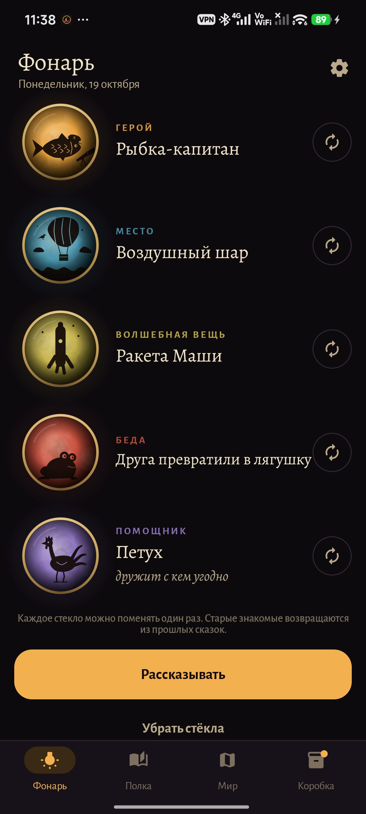
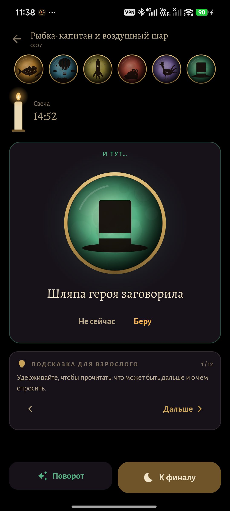
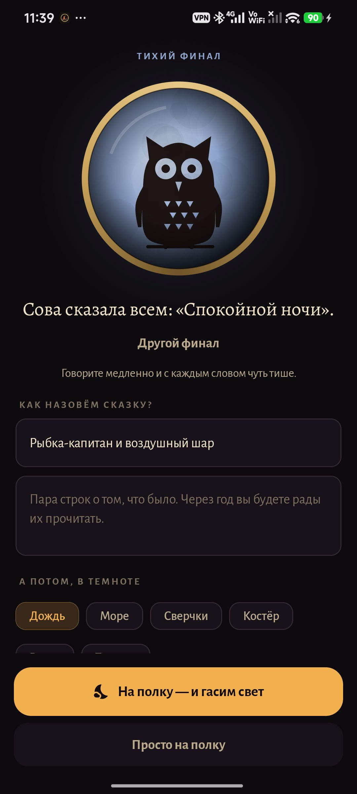
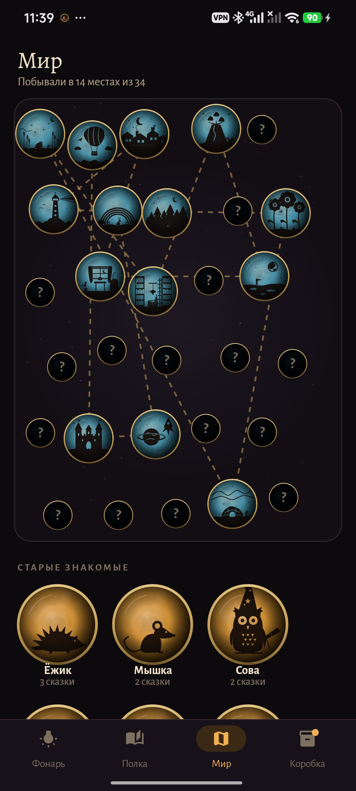
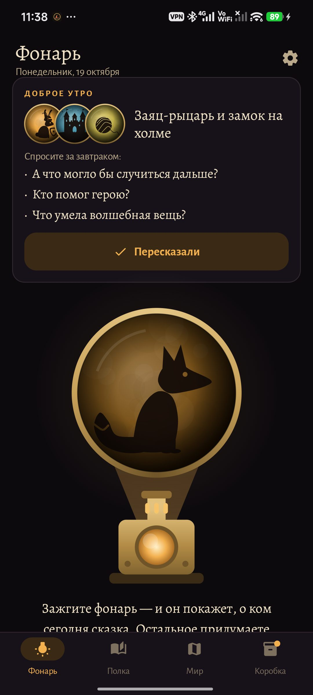
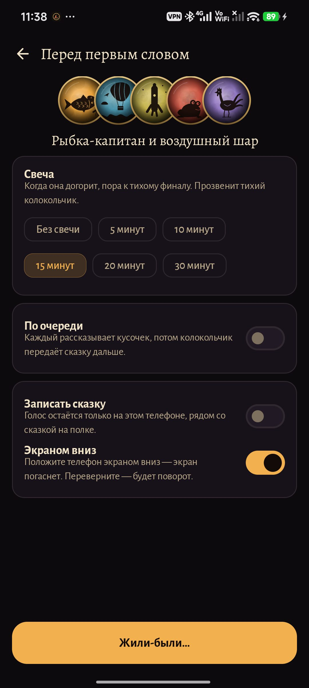
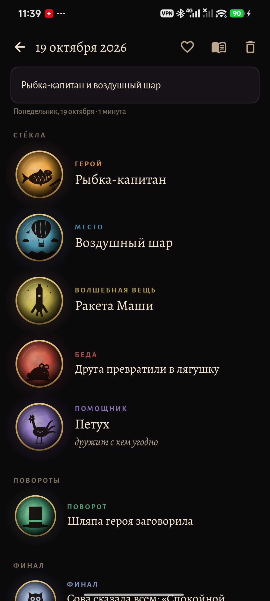
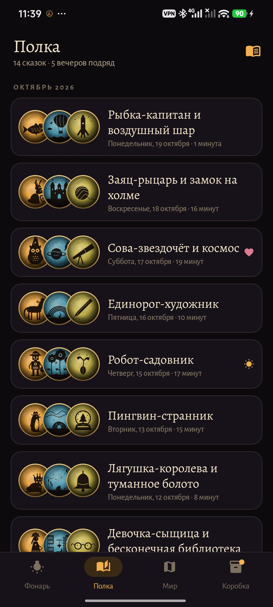
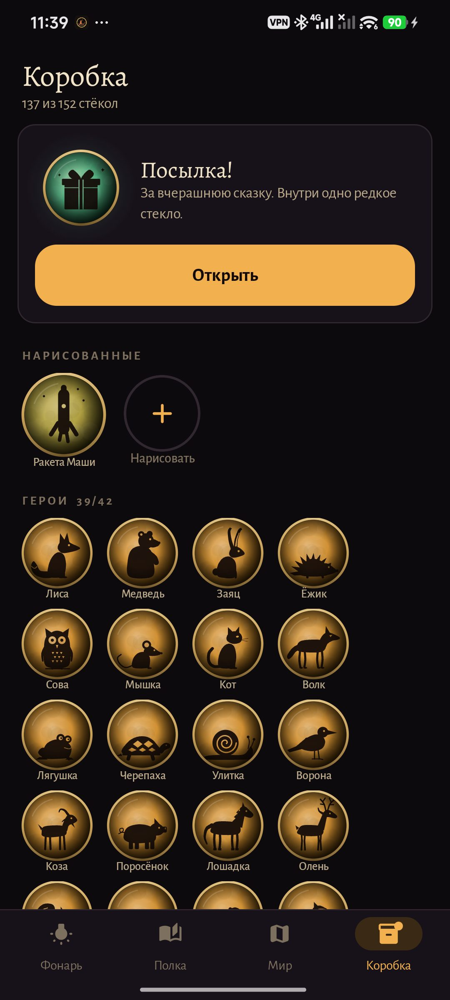

<div align="center">


# Фонарь

### Сказки на ночь, которые придумываете вместе.

*Волшебный фонарь в телефоне: зажгите его, и выпадут расписные стёкла — герой, место, волшебная вещь, беда, помощник. Из них родитель и ребёнок вместе придумывают сказку, положив телефон экраном вниз. Бесплатно, без рекламы, без аккаунта и без доступа в интернет.*

[](https://github.com/bigdevwhale/lantern/actions/workflows/android.yml)
[](https://github.com/bigdevwhale/lantern/releases/latest)

[](LICENSE)

[English](README.md) · **Русский** · [Изменения](CHANGELOG.md)

   

</div>

---

## Как это устроено

1. **Зажгите фонарь** (или потрясите телефон). Стёкла выпадают по одному: герой с профессией («Мышка-фонарщица», «Лиса-капитан»), место, волшебная вещь со своей силой, беда, помощник и, если хотите, странность героя. Каждое стекло можно поменять один раз.
2. **Рассказывайте.** Положите телефон экраном вниз — экран погаснет. Переверните — фонарь подбросит поворот. Свеча подскажет, когда пора заканчивать. Если рассказывать по очереди, колокольчик передаёт сказку следующему. Удерживайте карточку для взрослого: там следующий шаг сказки (по Проппу) и вопрос, который можно задать ребёнку.
3. **Тихий финал.** Стекло финала, название для сказки — и свет гаснет под шум дождя, моря, сверчков, костра или ветра. Звук создаётся прямо в телефоне.

## Что ещё

| | |
|---|---|
| 🎞 **Много стёкол** | 42 героя × 28 профессий, 34 места, 48 волшебных вещей × 40 сил, 38 бед (три уровня страшности), 30 умений помощников, 32 странности, 36 поворотов, 18 финалов. Все силуэты нарисованы кодом в духе теневых фильмов Лотты Райнигер. |
| 🧒 **Малыши / постарше** | От трёх до пяти: герой, место, может быть вещь. От шести: полный набор. |
| 👋 **Старые знакомые** | Герои прошлых сказок возвращаются. Любого можно позвать в сегодняшнюю сказку со вкладки «Мир». |
| 🗺 **Мир** | Ночная карта всех мест, где побывали ваши сказки, соединённых пунктирной дорогой. |
| 📦 **Коробка** | За каждый вечер со сказкой приходит посылка с одним редким стеклом. Зимние стёкла выпадают зимой. |
| 🖌 **Нарисованные** | Ребёнок рисует пальцем своего героя, помощника, место или вещь — и они тоже выпадают из фонаря. |
| 📞 **Сказка на расстоянии** | По одному пятизначному коду на двух телефонах выпадают одинаковые стёкла — для того, кто далеко. |
| 🎙 **Полка** | Каждая сказка хранится со своими стёклами, парой строк и, если хотите, записью голоса. Продолжения с тем же героем. Маленькая PDF-книжка для печати. |
| ☀️ **Утро после** | Виджет и карточка со вчерашними стёклами и тремя вопросами, чтобы пересказать сказку. |

## Приватность

Нет аккаунта, облака, аналитики и разрешения на интернет. Микрофон используется, только если вы сами решили записать сказку, и запись остаётся на телефоне.

## Скриншоты

    

## Сборка

```bash
./gradlew assembleDebug             # app.lantern.dev
./gradlew assembleDebug -Pdemo      # app.lantern.demo, три недели сказок выдуманной семьи
./gradlew testDebugUnitTest         # тесты
./gradlew testDebugUnitTest -Prender --tests '*RenderArt*'   # все силуэты в app/build/art
```

Kotlin, Jetpack Compose, Room, DataStore. Шрифты: Alegreya и Alegreya Sans (OFL).

Часть [Stillcraft](https://bigdevwhale.github.io/stillcraft/). Лицензия MIT.
